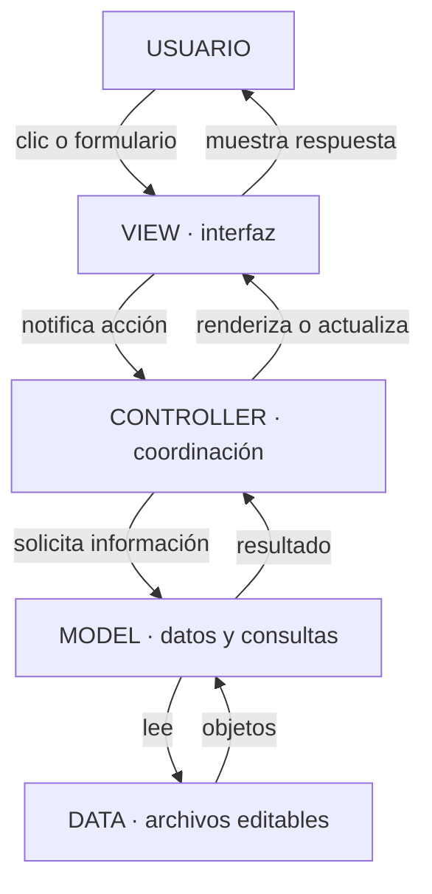

# NexoBajío · Landing page educativa con MVC

Una comunidad que conecta personas con tecnología. Proyecto completo, editable y sin frameworks, realizado con **HTML5, CSS3 y JavaScript Vanilla**. No requiere instalación para abrir su versión principal.

## Empieza aquí

1. Extrae **todo** el ZIP `NexoBajio_Landing_MVC.zip`.
2. Entra en la carpeta `NexoBajio`.
3. Abre **`index.html`** con doble clic en Microsoft Edge, Chrome, Firefox o Safari recientes.

Conserva juntas las carpetas `css`, `js` y `assets`. Abrir solo el HTML desde dentro de un ZIP puede impedir que el navegador encuentre los demás archivos.

**No hay que ejecutar npm, instalar paquetes ni iniciar un servidor para usar `index.html`.** La página, la ilustración, los eventos, los filtros, el FAQ y la simulación del formulario funcionan con archivos locales. No utiliza Google Fonts, CDN, imágenes externas, cookies, analítica ni almacenamiento de mensajes. Solo recuerda en `localStorage` si elegiste el modo claro u oscuro.

La segunda entrada, **`index.modulos.html`**, muestra exactamente la misma página y carga los archivos originales mediante módulos ES6. Esa entrada sí necesita un servidor local.

## Qué incluye

- Navbar con menú móvil, cierre por Escape y enlaces internos.
- Hero con ilustración SVG local de personas, nodos y conexiones.
- Presentación de la comunidad y seis formas de participar en sus actividades.
- Trece áreas de tecnología con iconos y descripciones.
- Eventos generados desde datos, filtros por formato y ventana de detalles.
- Ocho temas de orientación que preparan el asunto del contacto.
- Perfiles de la comunidad y tres formas de participar: asistir, aprender y compartir.
- Siete preguntas frecuentes con botones accesibles y navegación por teclado.
- Formulario con validación de campos, errores específicos y confirmación simulada.
- Footer, canales configurables, año automático y enlace para volver arriba.
- Diseño con Grid, Flexbox, media queries, foco visible y movimiento reducido.
- Modo oscuro con botón en la cabecera; respeta la preferencia del sistema y recuerda tu elección.
- Metadatos SEO, Open Graph básico y favicon SVG.

Los eventos son **DATOS DE DEMOSTRACIÓN**. Las fechas, ubicaciones, ponentes y costos no constituyen convocatorias reales. El correo utiliza el dominio de ejemplo `.example`, y las redes permanecen como “próximamente” hasta configurarlas. El formulario **no envía ni guarda información**, incluso cuando la validación es correcta.

## Primero entiende este flujo

**DATOS DE EVENTOS → MODEL → CONTROLLER → VIEW → HTML.**

Ejemplo real: `js/data/events.js` contiene los objetos; `EventModel` los ordena y filtra; `EventController` pide el resultado; `EventView` crea los elementos; éstos aparecen como tarjetas dentro de `#events-grid`.

La tarjeta no está escrita manualmente en `index.html`. Si agregas un cuarto objeto al arreglo, la vista puede generar una cuarta tarjeta sin duplicar HTML.

### Diagrama MVC y flujo de regreso



En este proyecto el modelo recibe los datos al construirlo, en lugar de descargarlos cada vez. El diagrama expresa responsabilidades, no peticiones de red.

**Regreso de una consulta:** DATA entrega objetos al MODEL; el MODEL devuelve resultados al CONTROLLER; el CONTROLLER pide a la VIEW actualizar la interfaz; el USUARIO ve las tarjetas o el mensaje. Al pulsar “Talleres”, la vista notifica esa categoría y el ciclo se repite.

**MVC adaptado:** no hay backend ni framework. Los modelos no consultan el DOM; las vistas no deciden reglas de negocio; los controladores coordinan. `validators.js` reúne reglas puras de validación. `NavigationController` resuelve acciones pequeñas de interfaz que no requieren otro modelo.

## Estructura completa

Todas estas rutas son relativas a la carpeta `NexoBajio`:

| Archivo | Responsabilidad |
| --- | --- |
| `index.html` | Página principal para abrir con doble clic. Estructura semántica y contenido. |
| `index.modulos.html` | Misma página usando ES6; generada desde `index.html`. |
| `css/reset.css` | Reglas base para diferencias entre navegadores. |
| `css/variables.css` | Colores, tipografía, medidas y variables compartidas. |
| `css/styles.css` | Diseño de secciones y componentes. |
| `css/animations.css` | Animaciones de entrada, revelado al hacer scroll y movimientos decorativos. |
| `css/responsive.css` | Adaptación a tamaños de pantalla, impresión y movimiento reducido. |
| `js/data/events.js` | Única fuente de eventos para las dos entradas. |
| `js/data/community.js` | FAQ, correo y redes sociales editables. |
| `js/models/EventModel.js` | Consulta y ordenación de eventos. |
| `js/models/CommunityModel.js` | Acceso a preguntas y configuración de contacto. |
| `js/views/EventView.js` | Tarjetas, estados de filtros y diálogo de detalles. |
| `js/views/FAQView.js` | Preguntas, respuestas y estados accesibles. |
| `js/views/ContactView.js` | Campos, errores, confirmación y enlaces de contacto. |
| `js/controllers/EventController.js` | Coordina filtros y detalles de eventos. |
| `js/controllers/FAQController.js` | Decide qué pregunta permanece abierta. |
| `js/controllers/ContactController.js` | Valida y coordina el formulario. |
| `js/controllers/NavigationController.js` | Menú móvil, accesos al contacto y volver arriba. |
| `js/controllers/ThemeController.js` | Botón de modo claro/oscuro y preferencia guardada. |
| `js/controllers/ScrollController.js` | Revelado al hacer scroll, barra de progreso, sección activa del menú y parallax. |
| `js/utils/dom.js` | Creación segura de nodos, iconos, fechas y foco. |
| `js/utils/validators.js` | Validación pura del formulario y enlaces HTTPS. |
| `js/app.js` | Punto de entrada y conexión entre todas las piezas. |
| `js/app.offline.js` | Copia agrupada de los módulos para `file://`; no se edita directamente. |
| `assets/icons/favicon.svg` | Favicon vectorial local. |
| `assets/images/conexiones.svg` | Ilustración original del hero. |
| `tools/build_offline.py` | Regenera la entrada ES6 y el script para doble clic. |
| `tools/check.mjs` | Pruebas de modelos, controladores y validaciones. |
| `docs/GUIA_DE_CODIGO.md` | Ruta de lectura y explicación de conceptos de programación. |
| `docs/VERIFICACION.md` | Resultados, alcance de comprobaciones y revisión manual sugerida. |
| `package.json` | Indica ES6 a Node para pruebas opcionales; no declara dependencias. |
| `README.md` | Esta guía. |

## Dos formas de ejecución

### A. Doble clic: uso más sencillo

Abre `index.html`. Carga, en orden, `events.js`, `community.js` y `app.offline.js` mediante scripts normales con `defer`. El navegador analiza primero el HTML y ejecuta después los scripts conservando su orden.

El archivo agrupado se entrega ya construido. Los datos permanecen fuera del agrupado, de modo que **editar eventos o preguntas no requiere reconstruir nada**. Guarda el archivo y recarga la página.

### B. Módulos ES6: para estudiar y desarrollar

Los navegadores suelen bloquear imports ES6 desde `file://` por sus reglas de origen. No desactives su seguridad. Utiliza un servidor local para abrir `index.modulos.html`.

Con Python instalado, abre una terminal dentro de `NexoBajio` y ejecuta:

```bash
python -m http.server 8000 --bind 127.0.0.1
```

En algunos sistemas el comando se llama `python3`; en Windows también puedes usar `py`:

```bash
py -m http.server 8000 --bind 127.0.0.1
```

Visita [http://localhost:8000/index.modulos.html](http://localhost:8000/index.modulos.html). Para detenerlo, presiona `Ctrl+C` en la terminal. El parámetro `--bind 127.0.0.1` limita el servidor a tu equipo.

Con **VS Code Live Server**: abre la carpeta del proyecto, instala la extensión Live Server si aún no la tienes, pulsa con el botón derecho sobre `index.modulos.html` y selecciona **Open with Live Server**. Si se abre `index.html`, cambia el final de la URL a `index.modulos.html`.

Estos servidores sirven archivos para desarrollo; no agregan backend al formulario ni publican automáticamente la página en internet.

### Cómo se mantienen sincronizadas las dos entradas

| Qué editaste | Qué necesitas hacer |
| --- | --- |
| `events.js` o `community.js` | Guardar y recargar cualquiera de las dos páginas. |
| CSS o archivos SVG | Guardar y recargar cualquiera de las dos páginas. |
| `index.html` | Reconstruir para que `index.modulos.html` tenga el mismo contenido. |
| Modelos, vistas, controladores, utilidades o `app.js` | Reconstruir para actualizar la versión de doble clic. |

Reconstrucción opcional, con Python y sin paquetes adicionales:

```bash
python tools/build_offline.py
```

El script genera `js/app.offline.js` e `index.modulos.html`. Conserva comentarios y no minifica el código. Si agregas un nuevo módulo, añádelo a `MODULES` en orden de dependencia. Este empaquetador está deliberadamente limitado a los imports de una línea y exports de clases/funciones/constantes usados aquí; no es una herramienta general para cualquier proyecto JavaScript.

No edites directamente archivos generados: esos cambios se perderían al reconstruir.

## Cómo agregar un evento

Abre `js/data/events.js`. Dentro de `globalThis.NexoBajioData.events = [...]`, agrega un objeto y separa los objetos con comas:

```js
{
  id: 'seguridad-digital-demo',
  title: 'Primeros pasos en seguridad digital',
  category: 'Taller',
  startsAt: '2026-12-05T10:00:00-06:00',
  timeZone: 'America/Mexico_City',
  location: 'En línea · sesión de ejemplo',
  topic: 'Ciberseguridad',
  speaker: 'Persona facilitadora · demostración',
  description: 'Un ejemplo de taller para reconocer riesgos y mejorar los hábitos de seguridad digital.',
  audience: 'Personas sin experiencia previa.',
  duration: '90 minutos',
  cost: 'Por definir en una convocatoria real',
  isDemo: true
}
```

- Usa un `id` único, sin espacios, como `seguridad-digital-demo`.
- Las categorías iniciales son `Charla`, `Taller` y `Meetup`; deben coincidir exactamente con los filtros.
- `startsAt` usa fecha ISO con hora y desfase. La zona especificada evita desplazar la hora según el equipo del visitante.
- Si el evento ocurre en otra zona horaria, actualiza `timeZone`, el desfase de `startsAt` y la etiqueta de horario en `EventView.js`.
- Mantén `isDemo: true` para todo ejemplo. Usa `false` solo al introducir información real confirmada.
- La vista ordena todos los registros cronológicamente; **no elimina automáticamente eventos pasados**. Para mantener la sección “Próximos eventos”, retira o archiva los registros vencidos.
- Si dejas el array vacío, se muestra un estado sin eventos en lugar de romper la página.
- Para otra categoría, agrega también su botón en `#event-filters`, con `data-event-filter` igual al nuevo valor.

## Cambiar colores y tipografía

Edita `css/variables.css`. Por ejemplo:

```css
:root {
  --color-primary: #0F4C5C;
  --color-accent: #14B8A6;
  --color-accent-dark: #08766B;
}
```

La variante oscura del turquesa se utiliza para texto porque el turquesa brillante no ofrece el mismo contraste sobre blanco. Revisa los estados hover, foco, error y los textos pequeños si cambias la paleta.

La tipografía toma Inter o Manrope si están instaladas; de lo contrario usa la fuente del sistema, como Segoe UI en Windows. **No hay peticiones a Google Fonts.** Para añadirlas posteriormente necesitarías una hoja externa o archivos locales con su licencia, y la primera opción dependería de internet.

Las formas del logotipo y la ilustración tienen sus propios colores dentro de los SVG; ajústalos allí si cambias toda la identidad visual.

## Cambiar textos, preguntas, correo y redes

| Contenido | Archivo |
| --- | --- |
| Hero, nosotros, actividades, áreas, orientación, perfiles, participación y etiquetas | `index.html` |
| Preguntas y respuestas | `js/data/community.js`, propiedad `faqs` |
| Agenda | `js/data/events.js` |
| Correo | `js/data/community.js`, propiedad `contact` |
| Redes sociales | `js/data/community.js`, propiedad `socialLinks` |
| Mensajes de error | `js/utils/validators.js` |
| Confirmación simulada | `js/views/ContactView.js` |

Al contar con un correo real, cambia `contact.email` y establece `contact.isDemo = false`. Se convertirá en enlace `mailto:` y se retirará la advertencia de correo de ejemplo.

Para habilitar una red, sustituye su `url: ''` por la URL oficial completa con `https://`. Los valores vacíos o inválidos siguen mostrando “próximamente”; no crean enlaces rotos. Las nuevas pestañas utilizan `noopener noreferrer`.

## Agregar una sección

1. Agrega un bloque `<section id="nuevo-tema" class="section section-anchor" aria-labelledby="nuevo-titulo">` antes de `</main>`.
2. Incluye un encabezado `<h2 id="nuevo-titulo">` y el contenido del tema.
3. Si necesitas navegación directa, agrega un enlace `href="#nuevo-tema"` al menú.
4. Reutiliza `.container`, `.section-heading`, `.button` y las variables antes de crear estilos nuevos.
5. Si la sección contiene información dinámica, crea sus archivos de modelo, vista y controlador; conéctalos en `app.js` y agrega los nuevos módulos al empaquetador.
6. Ejecuta `python tools/build_offline.py` para actualizar ambas entradas.

## Cómo funciona el formulario

1. `ContactView` obtiene valores con `FormData`.
2. `ContactController` llama a `validateContact`.
3. Si hay errores, la vista los relaciona con los campos usando `aria-describedby`, establece `aria-invalid` y enfoca el primero.
4. Tras el primer intento, corregir un campo actualiza su error.
5. Si todo es válido, aparece una confirmación que dice explícitamente que **no se envió ni se guardó el mensaje**.

Reglas: nombre de 2–80 caracteres; correo con formato básico y máximo 254; perfil dentro de las opciones; asunto de 3–120; mensaje de 20–2000. El teléfono es opcional y, si se proporciona, admite de 7–15 dígitos con separadores y un `+` inicial. Se ignoran espacios exteriores.

Sin JavaScript el botón de envío queda deshabilitado, de modo que el navegador no intente enviar los datos mediante su comportamiento predeterminado. La validación no demuestra que un correo exista ni ofrece protección del lado servidor.

## Conectar un backend después

El punto de integración está señalado en `ContactController.js`, justo después de la validación exitosa.

- Crea un servicio separado que envíe una petición HTTPS mediante `fetch` a tu endpoint PHP, Node.js, función de Firebase, función de Supabase o API.
- Define los campos aceptados y repite validación, longitudes y tipos en el servidor. No confíes en el navegador.
- Añade estados de enviando, error y éxito; evita duplicar envíos y conserva lo escrito si la red falla.
- Confirma recepción solo después de una respuesta exitosa del servidor. Retira los avisos de simulación únicamente cuando haya entrega real y verificada.
- Configura reglas de acceso, límites de uso y protección contra abuso según el servicio. Nunca pongas contraseñas, claves privadas, claves de servicio o secretos de correo en estos archivos públicos.
- Define la política de tratamiento de datos correspondiente al formulario real.

No se incluye un backend ficticio ni un `fetch` a una URL inexistente. La simulación actual está completa para el alcance solicitado.

## Accesibilidad y seguridad

- Un solo `h1`, encabezados de sección, `header`, `nav`, `main`, `section`, `article`, `form` y `footer`.
- Enlace para saltar al contenido; botones reales; labels conectados por `for`/`id`; focos visibles.
- FAQ con `aria-expanded`, `aria-controls`, Enter/Espacio y flechas/Inicio/Fin.
- Diálogo nativo con Escape y devolución de foco; el botón de interés lleva al formulario.
- Menú móvil con estado expandido, cierre al seleccionar, clic exterior y Escape.
- `prefers-reduced-motion` elimina desplazamientos animados y transiciones.
- Valores dinámicos insertados mediante `textContent`, `createElement` y `replaceChildren`; sin `eval()` ni `innerHTML`.
- Enlaces sociales restringidos a HTTPS. Los datos del formulario no se almacenan en `localStorage`, cookies o servicios externos; solo se guarda la preferencia de tema.

## Verificación

Se incluyen pruebas automáticas sin dependencias. Si tienes Node.js instalado:

```bash
node tools/check.mjs
```

También puedes usar `npm test`, sin `npm install`. **Node no es necesario para abrir la landing.**

Consulta `docs/VERIFICACION.md` para conocer el alcance real de las comprobaciones. Las pruebas de lógica no sustituyen la revisión visual y funcional en un navegador real.

## ¿Qué leo primero para aprender?

1. Este README: responsabilidades y forma de ejecución.
2. `js/app.js`: dónde empieza la aplicación y cómo conecta las piezas.
3. `js/data/events.js` → `EventModel.js` → `EventController.js` → `EventView.js`.
4. `index.html`: dónde se insertan las tarjetas y cómo se divide la página.
5. Los cuatro CSS, en el mismo orden en que los carga el HTML.
6. `validators.js`, las vistas/controladores del FAQ y contacto.

Para definiciones y pequeños experimentos, continúa con `docs/GUIA_DE_CODIGO.md`.
